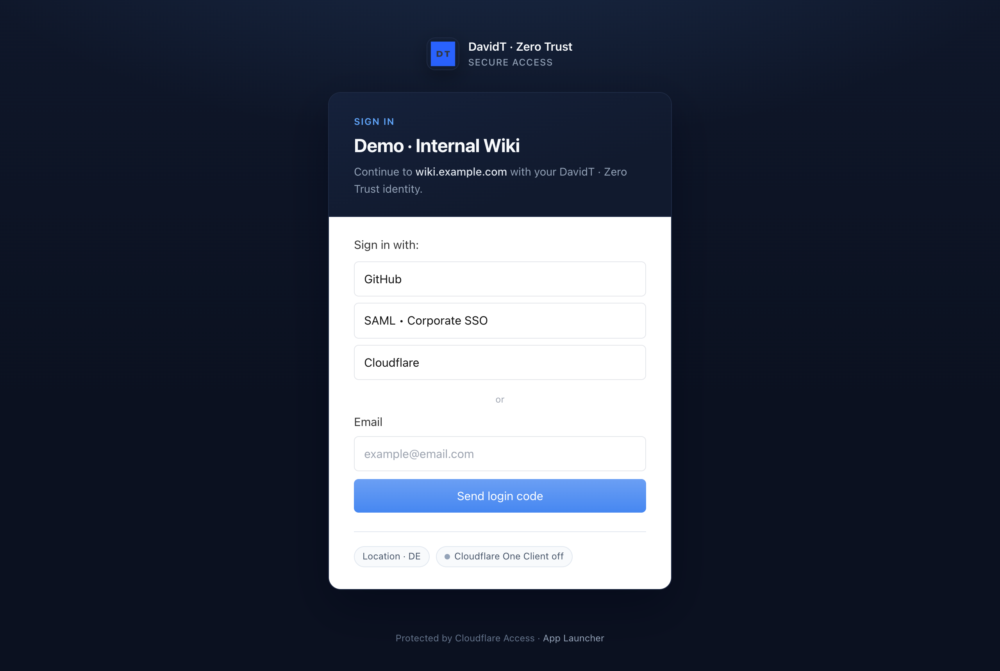
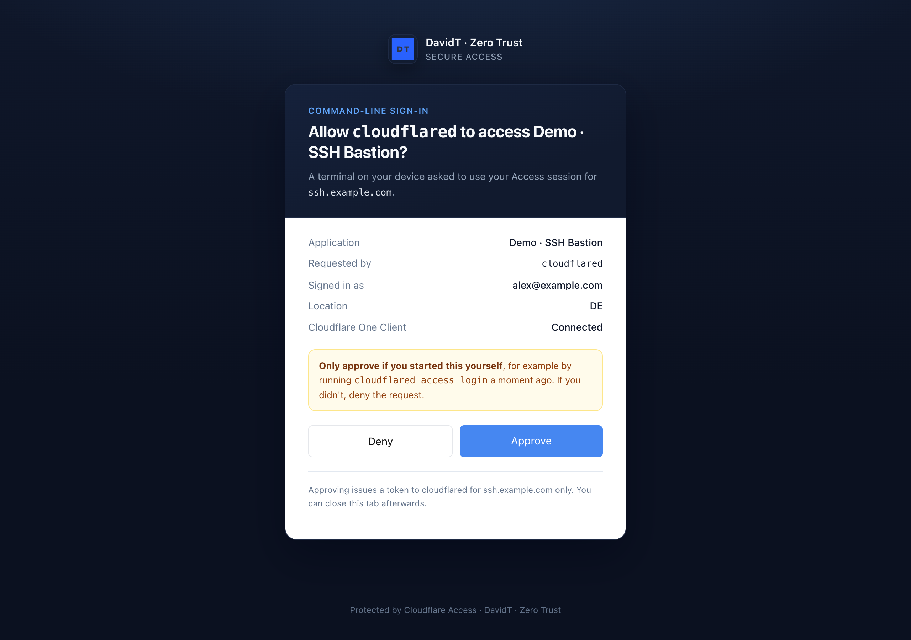
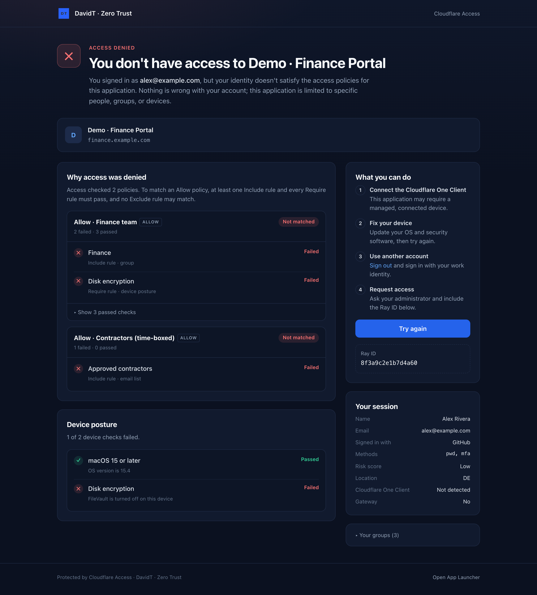
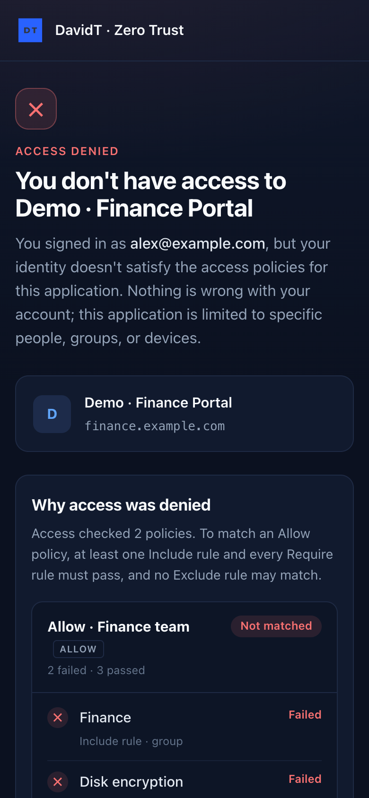
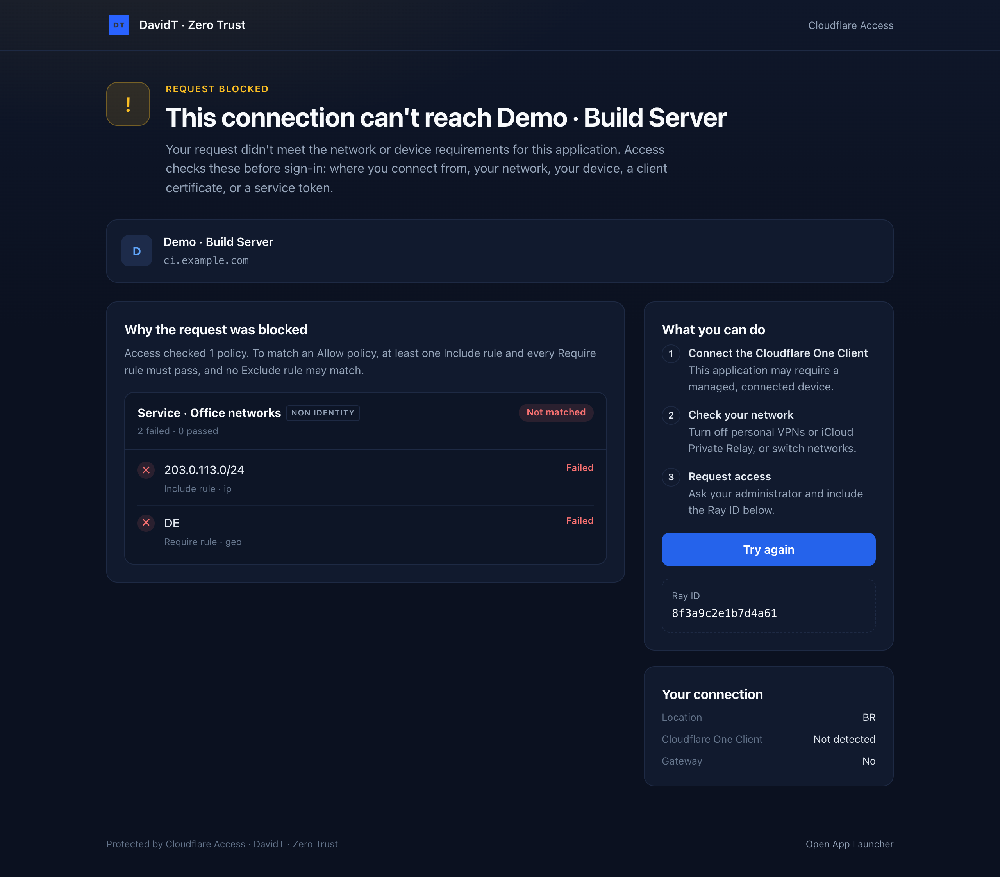
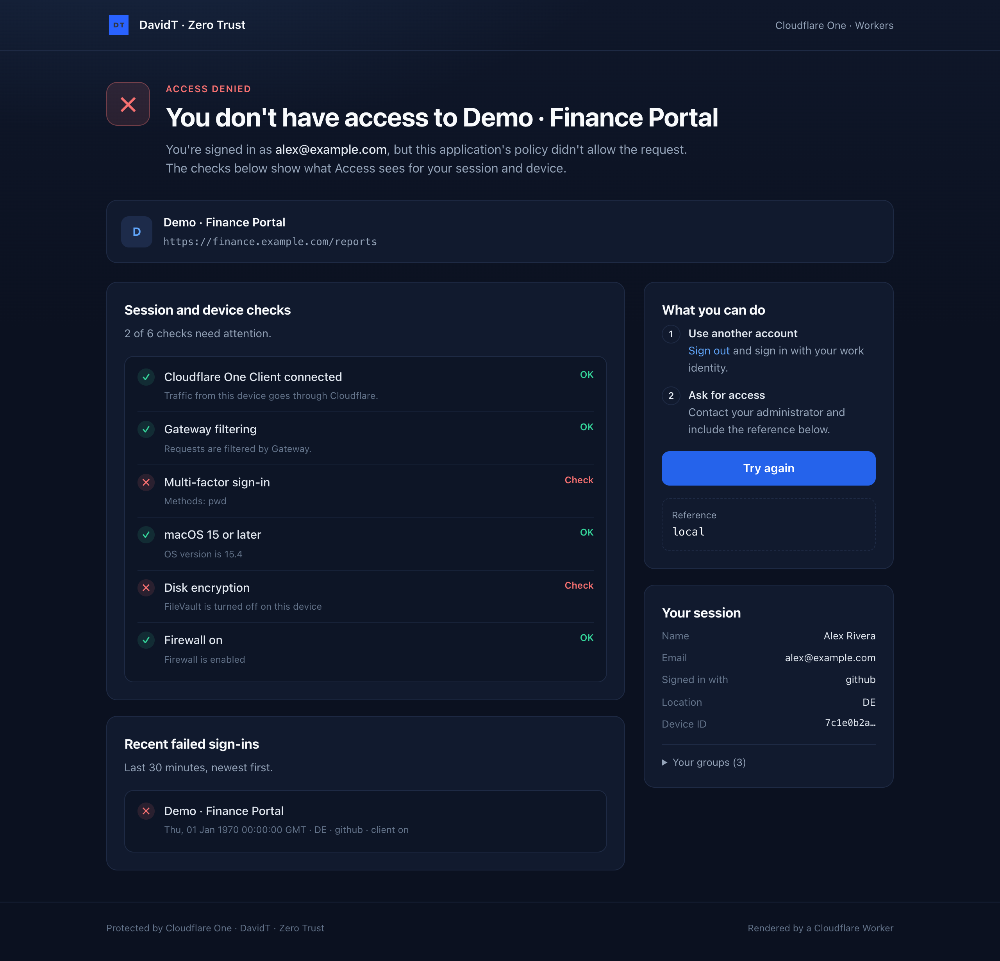
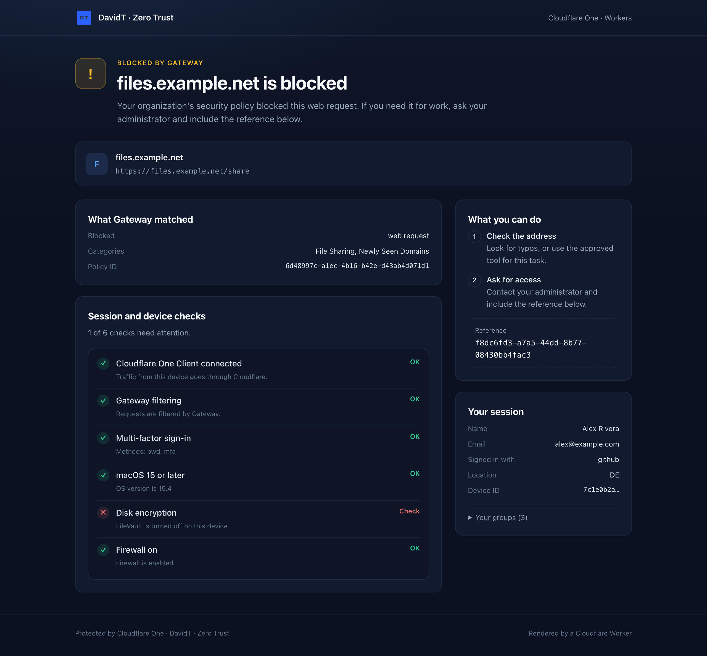

# Cloudflare One custom pages

Branded, user-facing pages for a Cloudflare One (Zero Trust) demo account, in a dark navy theme (`#0F172A`):

| Surface | What's in this repo | How it's applied |
| --- | --- | --- |
| Access sign-in | [`access-pages/login.html`](access-pages/login.html) | Liquid template, type **Login** |
| Access identity denial | [`access-pages/identity-denied.html`](access-pages/identity-denied.html) | Liquid template, type **Identity denied** |
| Access non-identity denial | [`access-pages/forbidden.html`](access-pages/forbidden.html) | Liquid template, type **Forbidden** |
| `cloudflared` approval | [`access-pages/interstitial.html`](access-pages/interstitial.html) | Liquid template, type **Interstitial** |
| App Launcher | [`brand.json`](brand.json) | Account setting |
| Gateway block page | [`brand.json`](brand.json) | Account setting |
| Dynamic denial page | [`worker/`](worker/) | Cloudflare Worker, used as a redirect URL |

The Liquid templates use [Access custom pages](https://developers.cloudflare.com/cloudflare-one/reusable-components/custom-pages/access-custom-pages/), launched [27 October 2026](https://developers.cloudflare.com/changelog/post/2026-10-27-access-custom-pages/). The Worker is a dependency-free take on [cloudflare/cf-identity-dynamic](https://github.com/cloudflare/cf-identity-dynamic). In a demo you can switch an application between the two.

## Screenshots

Captured from the local previews (`npm run preview` and `wrangler dev`) with the sample data in this repo. In the Access previews the sign-in and approval controls are look-alikes; on a live page, Access injects the real ones.

### Access custom pages

| Login | CLI approval (Interstitial) |
| --- | --- |
|  |  |

**Identity denied**: each evaluated policy with its failed rules, then device posture, next steps, the Ray ID and session details. Shown on desktop and on a phone.

<table>
  <tr>
    <td width="72%"></td>
    <td></td>
  </tr>
</table>

**Forbidden**: the same layout for checks that run before sign-in, here an IP and country service-auth policy.



### Workers identity page

| Redirected by Access (`?demo=access`) | Redirected by Gateway (`?demo=gateway`) |
| --- | --- |
|  |  |

## Access templates

Each template is a standalone HTML file, so you can paste it straight into **Cloudflare One → Reusable components → Custom pages → Access custom pages → Create custom page**. The brand name, logo and App Launcher link are `` lines at the top of each file. Colors are the `:root` tokens in its `<style>`.

The App Launcher link uses the placeholder `your-team.cloudflareaccess.com`. `npm run deploy:pages` replaces it with `CF1_TEAM_DOMAIN`. If you paste a template into the dashboard by hand, replace the placeholder yourself.

What each page shows:

- **Login**: application name and domain, sign-in status messages (`message.level`), and connection chips (country, Cloudflare One Client, Gateway). Access injects the identity provider buttons and the one-time PIN form into `<cf-access-authbox>`. They render in Cloudflare's own white style and use `org.text_color` for labels, so they sit on the light half of a two-tone card.
- **Identity denied**: every evaluated policy from `policy_evaluation`, with failed rules first and passed rules collapsed, plus device posture results, session details (IdP, auth methods, risk score), groups, next steps, and the Ray ID.
- **Forbidden**: the same layout, written for checks that run before sign-in (location, IP, device, certificate, service token).
- **Interstitial**: what's asking for the session (`requesting_tool`), for which app and user, plus a "only approve if you ran this" warning around `<cf-access-cli-approval>`.

Sandbox rules found while building these. The validator enforces them, and the docs only partly cover them:

- No `<script>`, inline event handlers, `<svg>`, `<button>`, `<form>`, `<link>`, `<meta http-equiv>`, or `@import`/`url()` in CSS. Use system fonts, Unicode glyphs and CSS shapes; `` with HTTPS URLs works.
- Liquid treats an empty string as true, and Access sends some fields empty (for example `ray_id`). Check strings with ``, not ``.
- `policy_evaluation` can be absent, for example when a service-auth (`non_identity`) policy fails. Every template has a fallback.
- When you create a template through the API, send `contract_version` (the `version` returned by `/access/custom_pages/validate`). Without it the page is stored as a legacy page and the Liquid is shown verbatim.

### Preview locally

The dashboard editor validates but doesn't render. This repo renders each template with [LiquidJS](https://liquidjs.com/) and sample data matching the variable contract shown in the editor ([`access-pages/samples.json`](access-pages/samples.json)):

```bash
npm install
npm run preview
```

Open <http://localhost:4173>. The sign-in and approval controls are look-alike mocks, so always confirm against a real, isolated Access application.

### Deploy with the API

```bash
export CLOUDFLARE_ACCOUNT_ID=<account id>
export CLOUDFLARE_API_TOKEN=<token>   # Access: Custom Pages Write, Access: Apps and Policies Write, Zero Trust Write
export CF1_TEAM_DOMAIN=<team>.cloudflareaccess.com
npm run validate          # validate all four templates, change nothing
npm run deploy:pages      # create or update them (matched by the names in brand.json)
```

Publishing saves the templates; it doesn't apply them. Assign them per application under **Additional settings → Custom block pages / Login page / Interstitial page**, or set account defaults. Application assignments override account defaults.

## App Launcher and Gateway block page

```bash
npm run deploy:branding
```

- **App Launcher**: navy header with the logo, light page background (the App Launcher draws text in black, so the page stays light), and a navy landing-page button. The command keeps existing footer links unless you set `appLauncher.footerLinks`.
- **Gateway block page**: custom Cloudflare-hosted block page with the name, logo, header and footer text, and a navy background. Set `gatewayBlockPage.mailtoAddress` to add a "Contact your administrator" link.

> [!WARNING]
> On the account this was tested against, `PATCH /accounts/{id}/gateway/configuration` with only `settings.block_page` removed other Gateway settings (`inspection`, `host_selector`, `sandbox`). `deploy:branding` therefore reads the current settings and sends them all back with the new block page. Still save `GET /gateway/configuration` before running it on an account you care about, and diff it afterwards.

## Workers identity page

[`worker/`](worker/) is a server-rendered, script-free page with a strict CSP. It uses the same design as the templates. It reads the visitor's identity from `get-identity` and shows:

- Cloudflare One Client and Gateway status, multi-factor sign-in, and whether the device is enrolled in this organization
- device posture results, which `get-identity` returns, so no API token is needed
- the Access context (`kid`, `original_url`) or Gateway policy context (`cf_site_uri`, categories, rule ID) it was redirected with
- optionally, with an `API_TOKEN` secret: the application name, and the visitor's failed sign-ins over the last 30 minutes

```bash
cd worker
npm install
cp .dev.vars.example .dev.vars
npx wrangler dev
```

Open <http://localhost:8787/?demo=access>, `?demo=gateway` or `?demo=identity` for sample data.

To deploy:

1. Set `routes`, `TEAM_DOMAIN` and, optionally, `ACCOUNT_ID` in [`worker/wrangler.jsonc`](worker/wrangler.jsonc).
2. Protect that hostname with an Access application whose policy your users pass. The page needs their Access JWT.
3. Run `npx wrangler deploy`.

Use it as:

- **Access**: on the application, set **Identity failure block page** and/or **Non-identity failure block page** to **Custom redirect URL** with the Worker's URL.
- **Gateway**: set the account block page, or a single policy, to **URL redirect** with **Send policy context** turned on.

### Switch an application between template and Worker

```bash
npm run demo:mode -- <access-app-id> worker https://identity.example.com/
npm run demo:mode -- <access-app-id> template
```

Both modes keep the branded login and CLI approval templates. Only the denial pages switch.

## Layout

```
access-pages/   Liquid templates + samples.json for local preview
brand.json      names, logo, colors, App Launcher and Gateway copy
docs/           screenshots used in this README
tools/          preview.mjs (local renderer), cf1.mjs (API deploy)
worker/         Workers identity page (wrangler)
```

Custom pages change what people see, not what Access decides. Query parameters on redirect URLs are visitor-controlled: show them as context, never treat them as proof.

## Disclaimer

This repository is for educational and demonstration purposes only. It is not an official Cloudflare product and is not supported by Cloudflare. Everything here is provided as is, without warranty of any kind. The authors accept no responsibility for any outage, misconfiguration, security issue or other damage resulting from its use. Review the code, and test it against an isolated application or account, before you apply it to anything you depend on. The scripts change live account settings.
